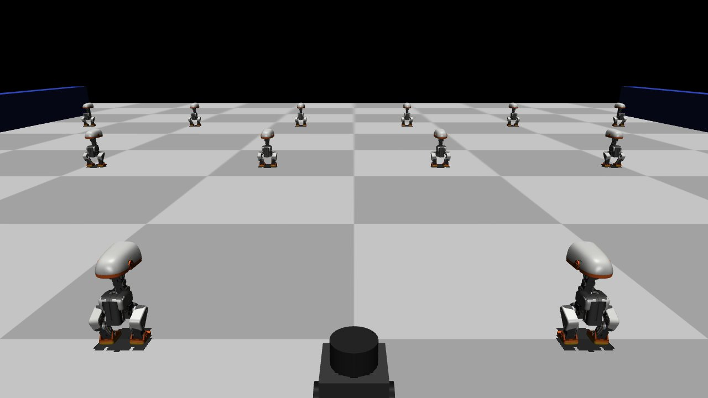
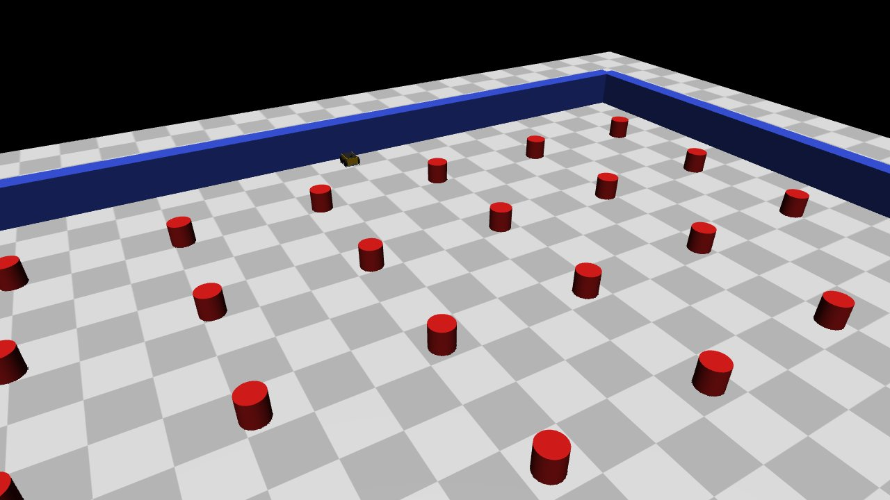
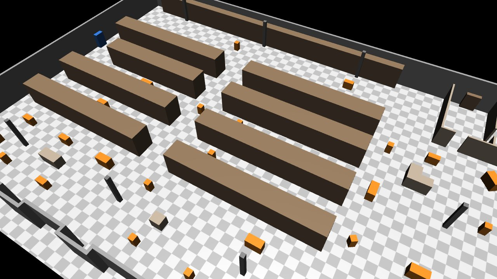
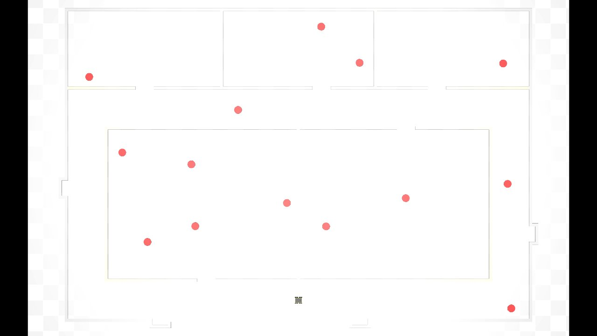
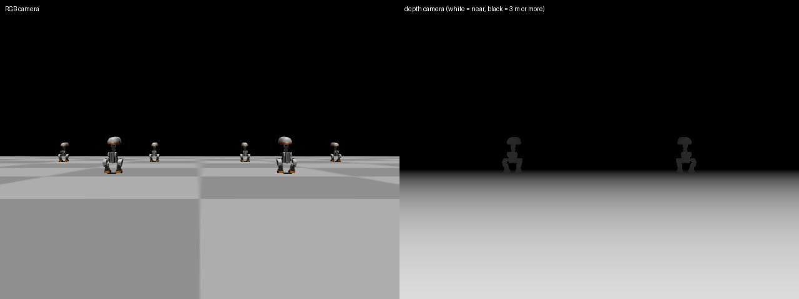

# dynabarn-core

A Python package for [DynaBARN](https://cs.gmu.edu/~xxiao2/Research/DynaBARN/DynaBARN.html)-style robot navigation among moving obstacles. It generates scenarios, simulates them in **MuJoCo** (the default) and streams the robot's sensors. It's meant as the base for DynaBARN projects such as ROS 2 nodes, learning setups and benchmarks: they `pip install dynabarn-core` and call `DynaBarn.get(...)` / `set_command(...)`. No ROS or simulator code lives in this package's core.

<p align="center">
  
  <br><sub>A TurtleBot3 Burger among <a href="#microducks-as-obstacles">Microducks</a> walking their lanes (<code>burger_lanes</code> preset, <code>obstacle_asset=microduck</code>).
  Microduck model © Pollen Robotics, CC BY-NC-SA 4.0.</sub>
</p>

<table>
  <tr>
    <td align="center"><br><sub>Jackal in the standard DynaBARN arena (<code>dynabarn_lanes</code>)</sub></td>
    <td align="center"><br><sub>Imported world-collection warehouse with its 28 moving carts (<code>MO2</code>)</sub></td>
  </tr>
  <tr>
    <td align="center"><br><sub>Our random obstacles placed only where they fit, in an imported office (<code>P1</code>)</sub></td>
    <td align="center"><br><sub>What the robot sees: RGB and depth cameras</sub></td>
  </tr>
</table>

| Simulator backend | Status |
| --- | --- |
| MuJoCo | Default. Export to MJCF and in-process simulation with lidar, IMU, odometry, joint states, contacts and cameras |
| gz-sim (modern Gazebo), Isaac Sim | Not yet; they plug in as backends (see [Adding a simulator](#adding-a-simulator)) |

## Quick start

```bash
pip install -e ".[dev]"              # from a clone; installs MuJoCo too

dynabarn list                                   # backends, generators, presets, trajectories, assets
dynabarn options lanes                          # a generator's options and defaults
dynabarn generate --preset burger_lanes --seed 7 -o out/burger.yaml          # from a preset
dynabarn generate lanes -s lanes=7 -s count=28 --seed 7 -o out/lanes.yaml    # or set options yourself
dynabarn view out/lanes.yaml --linear 0.5       # on-screen viewer; drive with the arrow keys
dynabarn run out/lanes.yaml --linear 0.5 --duration 60   # headless smoke run
pytest
```

In Python:

```python
from dynabarn_core import DynaBarn

db = DynaBarn.from_preset("burger_lanes", seed=1).start()   # simulation runs in the background
db.set_command(0.15, 0.0)                                    # m/s, rad/s
imu, scan = db.get("imu"), db.get_data("lidar")
db.stop()
```

## Running a scenario: `DynaBarn`

`DynaBarn` runs a scenario in a **background thread, in real time**. Your code reads the latest value of any sensor whenever it likes and sends velocity commands. Nothing waits on anything else.

```python
db = DynaBarn.from_preset("burger_lanes", seed=1)   # or DynaBarn("my_scenario.yaml")
db.start()
imu  = db.get("imu")               # SensorReading: .data (Imu), .stamp (sim time), .frame
scan = db.get_data("lidar")        # just the payload (LaserScan)
odom = db.get_data("odom")         # Odometry in the odom frame (starts at 0, 0, 0)
```

The thread advances physics in slices no longer than the fastest enabled sensor's period, so `get("imu")` really delivers a fresh 200 Hz sample every 5 ms (measured: 401 samples in 2 s).

| Getters | |
| --- | --- |
| `get(name)` / `get_data(name)` | Latest reading or payload of a sensor (None before the first one) |
| `wait_for(name, newer_than=None, timeout=1.0)` | Block until the sensor has a newer reading |
| `sensors()` | Every sensor: kind, frame, rate, enabled, **mount pose relative to the base frame**, full config |
| `observe()` | Snapshot: ground-truth pose and velocity, collisions, latest of every sensor |
| `time`, `realtime_factor`, `running`, `paused` | |

| Setters and control | |
| --- | --- |
| `set_command(linear, angular)` | Velocity command |
| `set_sensor_enabled(name, bool)` | Switch a sensor on or off at runtime |
| `configure_sensor(name, **changes)` | e.g. `configure_sensor("lidar", noise_std=0.02, rate_hz=10)` or `configure_sensor("odom", source="wheels")` |
| `subscribe(name or "*", callback)` | Callback for every new reading, on the simulation thread; returns an unsubscribe function |
| `start()`, `stop()`, `pause()`, `resume()`, `reset()` | |
| `step(command)` | Synchronous stepping instead of the thread, e.g. for RL or tests |

Options:
- **Speed:** `DynaBarn(..., realtime=1.0)`. `2.0` runs twice as fast; `None` runs as fast as possible.
- **Safety stop:** `command_timeout=0.5` stops the robot when commands stop arriving.
- **Sensors and noise:** `enable=["rgb"]`, `disable=["imu"]`, `seed=...` (for sensor noise), `control_hz=...`.

### Sensors

Each robot's `asset.yaml` lists its sensors. **Realistic extras are off by default**; switch them on in the YAML or at runtime.

```yaml
sensors:
  lidar:    {frame: base_scan, samples: 360, ..., rate_hz: 5, noise_std: 0.0}   # m
  imu:      {frame: imu_link, rate_hz: 200, gyro_noise_std: 0.0, accel_noise_std: 0.0}
  odometry: {frame: odom, rate_hz: 30, source: ground_truth,                  # or wheels
             linear_noise_std: 0.0, angular_noise_std: 0.0}
  joint_states: {rate_hz: 30}
  contact:      {rate_hz: 50}
  ground_truth: {rate_hz: 50}       # exact world pose, for evaluation
  cameras:
    - {name: rgb,   ..., rate_hz: 30, enabled: false}
    - {name: depth, ..., rate_hz: 30, enabled: false, depth: true}
```

| Sensor (`get` name) | Payload | Notes |
| --- | --- | --- |
| `lidar` | `LaserScan` | `inf` where nothing is within range |
| `imu` | `Imu` | Orientation, angular velocity, linear acceleration (includes gravity: +9.81 z at rest) |
| `odom` | `Odometry` | `ground_truth`: exact, relative to the start pose. `wheels`: integrated wheel rotation, which drifts when wheels slip (Jackal turns) |
| `joint_states` | `JointStates` | Wheel positions and velocities |
| `contact` | `Contacts` | What the robot is touching |
| `ground_truth` | `GroundTruth` | World pose and velocity |
| `rgb`, `depth` | `Image` | `rgb8` (H×W×3 uint8) / `32FC1` (H×W float32, metres). Need OpenGL (`MUJOCO_GL=egl` on headless machines) |

**Camera cost.** Cameras render on the simulation thread. Measured with both 640×480 cameras at 30 Hz:

| | Burger preset | Jackal preset |
| --- | --- | --- |
| GPU rendering (RTX 4060 Ti, `MUJOCO_GL=glfw`): max speed, cameras off / rgb / rgb + depth | 40× / 16× / 16× real time | 24× / 12× / 8× |
| GPU rendering, real-time mode | Stays real time, IMU 200 Hz | Stays real time, IMU 200 Hz |
| CPU rendering (`MUJOCO_GL=osmesa`): max speed, rgb / rgb + depth | 3.1× / 2.6× | 1.6× / 1.3× |
| CPU rendering, real-time mode | Stays real time, but `get("imu")` sees ~170 of 200 samples/s | Stays real time, `get("imu")` sees ~140 of 200 samples/s |

With a GPU, cameras only matter when running faster than real time. With CPU rendering, each frame takes 9–19 ms. Sensors still produce every sample in simulation time, but they arrive in bursts after each frame, so a `get()` poller misses some. Use `subscribe()` to receive every reading, or lower the camera `rate_hz` or resolution.

### Using it from a ROS 2 node (not included, not tested)

dynabarn has no ROS dependency. A node only needs `get` and `set_command`, which is the pattern this API is designed for:

```python
class DynaBarnNode(Node):
    def __init__(self):
        super().__init__("dynabarn")
        self.db = DynaBarn.from_preset("burger_lanes").start()
        self.imu_pub = self.create_publisher(Imu, "imu", 10)
        self.create_subscription(Twist, "cmd_vel", lambda m: self.db.set_command(m.linear.x, m.angular.z), 10)
        self.create_timer(1 / 200, self.publish_imu)        # any rate you like
        self.last = None

    def publish_imu(self):
        r = self.db.get("imu")
        if r is None or r is self.last:                       # only publish new samples
            return
        self.last = r
        self.imu_pub.publish(to_ros_imu(r.data, stamp=r.stamp, frame_id=r.frame))
```

`sensors()` gives each sensor's mount pose, which is what a static TF broadcaster needs.

## Scenarios

A scenario is a YAML file with an environment, a robot with its start and goal, and moving obstacles with their trajectories. Generators make them:

| Generator | Obstacles |
| --- | --- |
| `lanes` | Shuttle back and forth along evenly spaced lanes (`axis=row` or `column`) |
| `random` | Random loops: waypoints, or a bouncing walk (`bounce=true`) |
| `empty` | None: just the environment, e.g. an imported world with its own moving objects |

Common options (see `dynabarn options <generator>`):
- **Size and speed:** `count`; `speed`, or `speed_mode=agent|segment` with `speed_min`/`speed_max`; `dwell`; `stagger_phase`.
- **What goes in the world:** `obstacle_asset`, `robot_asset`, `environment`.
- **Start and goal:** `start_x/y/yaw`, or `spawn=S1` for one of the environment's own start poses; `goal_x/y`.
- **Where obstacles may move:** `area`, `keep_clear`, `static_clearance`, `min_clearance` (see below).

### Robots and presets

DynaBARN's arena and obstacles were designed for the Clearpath Jackal, so the generator defaults are a Jackal in the 20 × 20 m arena. For the much smaller TurtleBot3 Burger, use the `burger_*` presets: an 8 × 8 m arena with 0.1 m obstacles, scaled by the robots' size ratio (about 0.4).

| Preset | Robot | Arena | Obstacles |
| --- | --- | --- | --- |
| `dynabarn_lanes` | Jackal (0.51 × 0.43 m, skid steer, up to 2 m/s) | 20 × 20 m | 36 × r 0.25 m, 6 lanes, 1 m/s |
| `dynabarn_random` | Jackal | 20 × 20 m | 36 × r 0.25 m, random walks, 0.5–1.5 m/s |
| `burger_lanes` | TurtleBot3 Burger (0.21 m, up to 0.22 m/s) | 8 × 8 m | 18 × r 0.1 m, 6 lanes, 0.15 m/s |
| `burger_random` | TurtleBot3 Burger | 8 × 8 m | 16 × r 0.1 m, random walks, 0.08–0.2 m/s |

Presets are YAML files in `src/dynabarn_core/data/presets/`. Pass your own with `--preset path/to/file.yaml`, or override any option: `dynabarn generate --preset burger_lanes -s count=24 ...`.

### Where obstacles may go

Moving obstacles follow scripted paths and don't collide with each other in any simulator, so the generators decide where they may go:

- **Inside the area:** `area=bounds` (default) is the `x_min`…`y_max` rectangle. `area=environment` is the environment's free-floor outline, or its extent if it has none.
- **Away from walls and other static objects:** by at least `static_clearance` (default 0.1 m).
- **Away from the robot's start and goal:** by at least `keep_clear` (default 0.3 m), measured from the robot's outline, so a robot waiting there is never touched.
- **Never overlapping each other or the environment's own moving objects:** by at least `min_clearance` (default 0 m), checked over `check_horizon` seconds (default 120 s). `min_clearance=none` allows overlaps, as in the original DynaBARN.

How each generator achieves it:
- **`lanes`:** each lane is cut into its free stretches. Obstacles sharing a stretch each get their own section of it, `lane_gap` metres apart.
- **`random`, `layout=cells` (default):** one obstacle per grid cell, moving inside its own cell. Each leg of its path must be free, and it turns away from walls. Cells without usable floor are skipped, and the grid is refined if too few are usable.
- **`random`, `layout=free`:** obstacles roam the whole area and paths are re-drawn until they keep their distance. This only works for a handful of obstacles.

When something can't fit, generation stops with a message saying what to change. In an open arena everything is free, so the same seed still gives exactly the same scenario as before these rules existed.

## Assets

Robots, obstacles and environments are **assets**, looked up by `id`. The defaults ship inside the package (`src/dynabarn_core/data/assets/`); `dynabarn list assets` shows what's available. You can add or replace assets in three ways. For a given id the first match wins, so reusing a built-in id overrides it:

**1. In code**, with no files needed:

```python
from dynabarn_core import AssetLibrary
from dynabarn_core.assets import ObstacleAsset, EnvironmentAsset, Wall
from dynabarn_core.core import Cylinder

assets = AssetLibrary()
assets.add(
    ObstacleAsset(id="green_barrel", geometry=Cylinder(radius=0.3, length=0.9), color=(0.1, 0.6, 0.2, 1)),
    EnvironmentAsset(id="corridor", ground_size=(30, 12),
                     walls=(Wall("left", 0, 5, 0, (24, 0.2, 1)), Wall("right", 0, -5, 0, (24, 0.2, 1)))),
)
gen = create_generator("lanes", assets=assets, obstacle_asset="green_barrel")
```

**2. A folder of `asset.yaml` files**, passed as `AssetLibrary(["my_assets"])`, `dynabarn --assets my_assets ...` or `DYNABARN_ASSET_PATH=my_assets`. The easiest start is to copy a built-in asset and edit it:

```bash
dynabarn assets copy cylinder_small my_assets --as tall_post   # new asset 'tall_post'
dynabarn --assets my_assets generate --preset burger_lanes -s obstacle_asset=tall_post -o run.yaml
```

**3. The built-in defaults.**

```yaml
id: cylinder_red
kind: obstacle                  # robot | obstacle | environment
geometry: {type: cylinder, radius: 0.25, length: 0.5}   # box, cylinder, sphere or polygon
color: [0.8, 0.1, 0.1, 1.0]
representations: {}             # optional per-simulator files
```

Robots also describe their drive and sensors, plus one `representations` entry per simulator. `bindings` map dynabarn's generic names to the names inside that simulator's file, so you can swap in a different model without changing code.

**Obstacles with their own look.** An obstacle can bring its own MuJoCo model: `representations: {mujoco: {format: mjcf_fragment, path: model.xml}}`, a file with `<asset>` and `<worldbody>` geoms in the obstacle's frame. Its `geometry` stays the collision shape (invisible). The lidar and cameras see the model.

### Microducks as obstacles

[Microduck](https://github.com/pollen-robotics/microduck_rl) is Pollen Robotics' ~27 cm bipedal duck robot. `import-microduck` freezes it in its standing pose into one rigid obstacle. It then moves like any other obstacle, facing the way it walks:

```bash
git clone --depth 1 https://github.com/pollen-robotics/microduck_rl
dynabarn assets import-microduck microduck_rl -o duck_assets                       # real size, 12 x 14 x 27 cm
dynabarn assets import-microduck microduck_rl -o duck_assets --scale 2.5 --id microduck_big   # for the Jackal arena
dynabarn --assets duck_assets generate --preset burger_lanes -s obstacle_asset=microduck -o ducks.yaml
dynabarn --assets duck_assets view ducks.yaml --linear 0.15
```

**License:** the duck's meshes are **CC BY-NC-SA 4.0** (non-commercial, share-alike). They are never bundled with dynabarn-core. The command copies them from *your* clone into *your* asset folder, with their license and a `NOTICE.md` saying how they were modified. The ducks are posed models, not walking simulations; driving them with a trained Microduck walking policy would be a separate project.

## Importing worlds from other tools

Worlds made for other tools can be imported as environment assets, which every backend can then build. Importers keep **geometry and metadata only**. Simulator-specific parts such as Gazebo system plugins are dropped, because each backend adds what its simulator needs when it exports.

| Importer | Reads |
| --- | --- |
| `sdf` | Any SDF world whose static models use boxes, cylinders, spheres or polylines (extruded polygons). Anything it can't represent (meshes, `<include>`, tilted shapes, non-static models) is reported as a warning, never dropped silently |
| `world_collection` | A world folder from [mertgulerx/world-collection](https://github.com/mertgulerx/world-collection) (Apache-2.0): the SDF plus `world.yaml` start poses, free-space outline, doors, measured difficulty values and **moving objects**. Copies the world's LICENSE along with it |

```bash
git clone --depth 1 https://github.com/mertgulerx/world-collection
dynabarn import-world world-collection/worlds -o wc_assets       # all 43 worlds in about a second

# a world as it is (its own moving objects included, if any)
dynabarn --assets wc_assets generate empty -s environment=wc_mo2_warehouse_moving -s spawn=S1 -o mo2.yaml

# a world with our DynaBARN obstacles added, only where they fit
dynabarn --assets wc_assets generate random -s environment=wc_p1_racetrack_office -s area=environment \
    -s spawn=S1 -s count=12 -s bounce=true -s points=20 -o p1_dynamic.yaml
dynabarn --assets wc_assets view p1_dynamic.yaml
```

In Python: `res = import_world("path/to/world")`, then `AssetLibrary().add(res.environment)`, or `write_environment(res, "my_assets")`.

- **Their moving objects** (world-collection `MO1`, `MO2`: carts, boxes, pallet trucks) come in as the environment's `moving_objects`, with a `path` trajectory: loop or patrol through waypoints, pauses, turning on the spot, a start offset, integer-nanosecond timing. They're simulated by default; `-s environment_obstacles=false` turns them off.
- **Concave polygons:** MuJoCo collides meshes as convex hulls, so concave polygons are split into convex prisms automatically.

**Checked against all 43 world-collection worlds:**
- **Import:** every world imports, and object counts match the SDF. At every spawn, both robots start clear of walls and rest on the floor.
- **Geometry:** the free floor area computed from the imported geometry matches the author's measured value to 0.00% in 42 worlds, and 0.14% in the 500 m maze (coarser check grid). The author's tolerance is 2%.
- **Moving objects:** all 33 match the author's cycle lengths to the nanosecond, and their SDF start poses. Recomputing the author's own "closest any two objects get" check (sampled every 0.1 s over 7,800 s) from our trajectories gives **bit-identical** values.
- **Our obstacles in their maps:** generating lanes and random obstacles across 42 worlds × both robots (168 cases) gave **162 valid scenarios and 0 violations**. An independent check confirmed that no obstacle touches a wall over 120 s, none overlap each other or the world's own movers, all stay out of the start keep-clear zone, and a robot waiting 60 s at its start in MuJoCo is never touched. The other 6 were refused with a clear message, correctly: lanes that would cross `MO1`/`MO2`'s own carts, and one dead-end lane too short for its obstacles.

## Using it in your own project

```bash
pip install dynabarn-core            # not on PyPI yet: pip install "git+<repo-url>" or pip install /path/to/repo
```

[`examples/quickstart.py`](examples/quickstart.py) is a complete example covering custom assets in code, a generated scenario, and a simple controller loop that stops in front of obstacles. It runs headless or with `--view`. To step a simulation yourself instead of using `DynaBarn`:

```python
from dynabarn_core import create_generator, create_backend, VelocityCommand

scenario = create_generator("lanes", lanes=6, count=36, speed=1.2).build(seed=7)
backend = create_backend("mujoco")
artifacts = backend.export(scenario, "out/mujoco")
with backend.create_simulation(artifacts, control_hz=20) as sim:
    obs = sim.reset()
    while obs.time < 60 and not obs.in_collision:
        obs = sim.step(my_planner(obs.pose, obs.velocity, obs.scan))   # -> VelocityCommand(linear, angular)
```

## Adding a simulator

1. Write an `Exporter` that turns `Scenario` + `AssetLibrary` into the simulator's files.
2. Subclass `SimBackend` and set `capabilities` and `exporter_cls`. Then implement `create_simulation`, for an in-process simulator such as Isaac Sim, or `launch_command`, for an external one such as gz-sim.
3. Register it with `@BACKENDS.register("name")`, or as an entry point in your own package:
   ```toml
   [project.entry-points."dynabarn_core.backends"]
   isaac = "my_pkg.isaac:IsaacBackend"
   ```
4. Add the robot's file for that simulator under `representations` in its `asset.yaml`.

`SimBackend.check()` validates a scenario before export and lists any missing assets or representations.

## Architecture

```
src/dynabarn_core/
  core/         Pose2D, Bounds, shapes, trajectories, Scenario, messages, Registry   (no ROS, no simulators)
  assets/       asset.yaml manifests -> Robot/Obstacle/Environment dataclasses, search path
  generators/   scenario generators (lanes, random, empty), free-space queries
  importers/    world importers (sdf, world_collection), Microduck asset builder
  backends/     simulator adapters: SimBackend = Exporter + runtime (Simulation or launch_command)
    mujoco/     MuJoCo exporter, simulation, sensors, viewer
  runtime.py    DynaBarn: background thread, get() / set_command()
  data/assets/  built-in robots, obstacles and environments (shipped in the wheel)
  data/presets/ built-in presets
scenarios/      example scenario files
examples/       using dynabarn from your own code
docs/images/    README screenshots
```

Each layer depends only on the layers listed above it.

| Pattern | Where | Why |
| --- | --- | --- |
| Frozen dataclasses | `core`, `assets` | Plain, immutable, serialisable data |
| Strategy | `core.trajectories` | New motion types without touching backends |
| Registry + Factory | `core.registry`; `create_generator`, `create_backend` | Pick implementations by name (CLI, config files) |
| Entry points | `dynabarn_core.backends`, `.generators`, `.trajectories`, `.asset_kinds`, `.world_importers` | Add a simulator, generator or importer from a separate package |
| Adapter | `backends/*`, `importers/*` | One adapter per simulator or source format |
| Template Method | `Generator.build` | Generators only write `make_trajectories` |

Two rules keep the backends interchangeable:
- **Trajectories have a universal export form.** Every trajectory implements `pose_at(t)` and `as_waypoints()`. A simulator that can't call Python at runtime, such as a gz-sim C++ plugin, plays back the waypoints.
- **Simulations speak `core.messages`.** Backends produce `Observation` and `SensorReading` objects and accept `VelocityCommand`. Middleware such as ROS 2 or a Gym wrapper converts these, so simulators never import ROS and ROS code never imports a simulator.

## Notes

- **Robot models:** the MuJoCo robots use primitive shapes with the real dimensions and masses. The Burger tracks velocity commands to within about 2%. The Jackal is skid steer: in MuJoCo it turns at about 43% of what its physical 0.376 m track predicts, so its `asset.yaml` uses an effective `wheel_separation` of 0.87 m, which brings tracking within about 5%.
- **Lane overlap fix:** the original DynaBARN lane generator ran every obstacle in a lane along the same path, so they passed through each other. Its `passes` option is gone because the motion loops forever.

## Credits and licenses

- **dynabarn-core:** BSD-3-Clause.
- **[world-collection](https://github.com/mertgulerx/world-collection)** by Mert Güler, Apache-2.0. Imported worlds keep its LICENSE; the `MO2` and `P1` screenshots show imported worlds.
- **[Microduck](https://github.com/pollen-robotics/microduck_rl)** by Pollen Robotics: code and MJCF Apache-2.0, **meshes CC BY-NC-SA 4.0**. Not bundled; built from your own clone. The screenshots showing Microducks (`docs/images/microducks_lanes.jpg`, `docs/images/robot_cameras.jpg`) are renders of those meshes and are therefore licensed CC BY-NC-SA 4.0, © Pollen Robotics.
